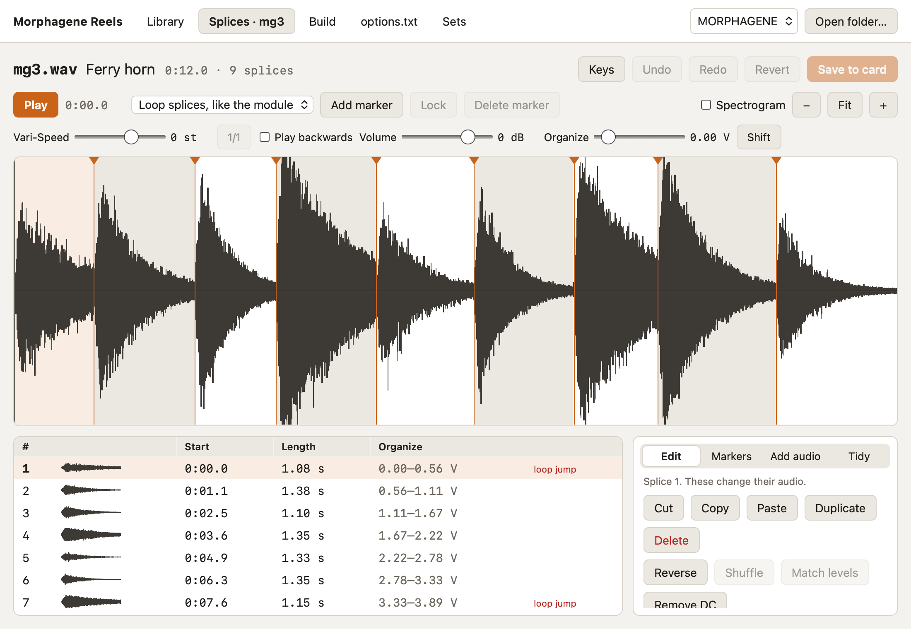

# Morphagene Reels

A Mac app for the Make Noise Morphagene's microSD card: the reels on it, the
splices in them, and the cards you keep for later.

[Install](#install) · [Guide](docs/) · [Command line](docs/command-line.md) ·
[Report a problem](https://github.com/rlhatcher/mgreel-rs/issues)


## About

The Morphagene keeps its reels on a microSD card as WAV files named `mg1.wav`
to `mgw.wav`, with each splice marked by a cue point. Morphagene Reels opens
that card and shows it the way the module sees it: 32 slots, the colour each
reel takes in Reel mode, and about where Organize selects it. From there you
edit splices, build new reels, and keep whole cards as sets.

Everything works on files on your Mac. Before the app changes a file on the
card it copies the old one to a backups folder, and when a card mounts it
copies any reel recorded on the module that it hasn't seen yet.

The repo also builds `mgreel`, a command-line tool that joins WAV files into a
reel. It started as a Rust port of [Oliver Tonnhofer's
mgreel](https://github.com/olt/mgreel).

## Features

**The card**

- The 32 slots as tiles, with each reel's name, note, length against the 2.9
  minute limit, and splice markers.
- Drag a reel to move it, Option-drag to swap two. Names move with their
  reels.
- A card check: reels the module can't play, WAV files it won't load because
  of their name or folder, macOS `._` files, and a card that isn't FAT32. Each
  has a fix.
- Back up, restore and eject the card, and put back any single file from its
  history.

**Splices**

- Playback that behaves like the module: a splice loops until Organize or
  Shift picks the next, with Vari-Speed from 12 semitones up to 26 down.
- Add, drag, lock and delete markers, snap them to zero crossings, split
  evenly, or let auto-slice find splices in any sound by level and spectrum.
- Cut, copy, paste, duplicate, reorder, reverse, shuffle, fade, normalize,
  match levels, smooth loops, high-pass and change speed, all with undo.
- Each splice's Organize voltage range, and a flag on splices that jump from
  end to start.

**Getting audio in**

- Build a reel from WAV files of any rate, depth or channel count, with trims,
  normalize and fades. Cue points and region ends saved in the files become
  splices.
- Import markers from Audacity labels, a REAPER marker export, an Ableton Live
  set's locators, or another WAV file.
- Tidy a reel recorded on the module: delete silent splices, trim silent
  starts, merge splices that are too short.

**Sets and options**

- Keep whole cards in `~/Music/Morphagene Sets` and load one back onto any
  card. Import a downloaded reel pack as a set.
- Edit `options.txt` as a form; only the values change.



## Install

The app needs a Mac with Apple Silicon.

### With Homebrew

```bash
brew tap rlhatcher/mgreel https://github.com/rlhatcher/mgreel-rs
brew trust --cask rlhatcher/mgreel/morphagene-reels
brew install --cask rlhatcher/mgreel/morphagene-reels
```

`brew upgrade` keeps it current. The app is ad-hoc signed, not notarized by
Apple, so the cask clears the quarantine flag Homebrew sets and it opens
without a warning.

### From a release

Download `Morphagene-Reels-<version>-arm64.dmg` from
[Releases](https://github.com/rlhatcher/mgreel-rs/releases) and drag the app to
Applications. macOS blocks the first launch, because Apple hasn't notarized
it: allow it in System Settings, Privacy & Security, Open Anyway.

### The command-line tool

```bash
cargo install --locked --git https://github.com/rlhatcher/mgreel-rs.git mgreel-rs
```

This installs `mgreel`. See [the command line](docs/command-line.md).

### From source

See [development](docs/development.md).

## Guide

- [The Library](docs/library.md): the card, its slots, names, the card
  check, backups and history.
- [Splices](docs/splices.md): the editor, playback, markers and every tool.
- [Build](docs/build.md): a new reel from WAV files.
- [Sets](docs/sets.md): whole cards kept on your Mac, and reel packs.
- [options.txt](docs/options.md): the module's firmware options.
- [The command line](docs/command-line.md): `mgreel`.
- [Development](docs/development.md): building, testing and releasing.

## Not yet checked on a module

The app follows the Morphagene manual, but some of it hasn't been tried on
hardware yet:

- that the module ignores `mgreel.json`, the file where the app keeps reel
  names;
- how the module counts reels when there are empty slots between them;
- where the Organize zones fall in Reel mode, which the app spreads evenly.

## Acknowledgments

- [mgreel](https://github.com/olt/mgreel) by Oliver Tonnhofer, the original
  JavaScript tool this repo started from.
- [Make Noise](https://www.makenoisemusic.com/) for the Morphagene and its
  manual, which gives the reel format, limits and Reel mode.

## License

ISC. See [LICENSE](LICENSE).
