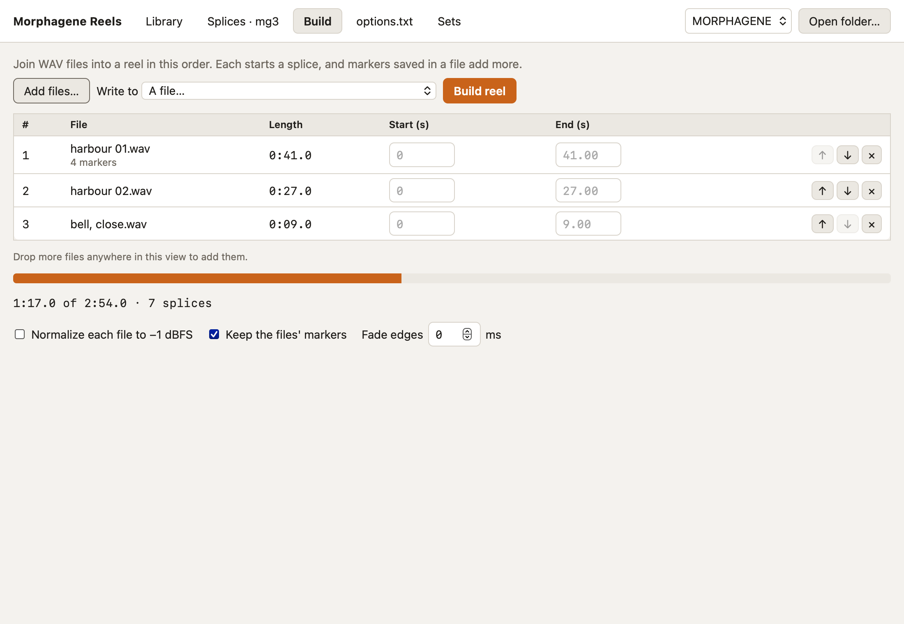

# Build

Build joins WAV files into a new reel, one splice each, in the order you list
them. Add them with **Add files…** or by dropping them anywhere on the page.
Any sample rate, bit depth, mono or stereo works; the reel is written as 48 kHz
32-bit float stereo.

## The files

Each row shows a file's length and how many markers it carries. Set **Start**
and **End** in seconds to use only part of a file. ↑ and ↓ reorder the files
and ✕ removes one.

The bar under the list fills toward the module's 2.9 minute limit, and the
line below it counts the splices. Build reel stays off while the reel would be
too long or have more than 300 splices.

## Options

- **Normalize each file to −1 dBFS** scales each file so its loudest sample
  sits just under full scale.
- **Keep the files' markers** turns the cue points saved in a file, and the
  region ends RX and Pro Tools save, into splices too, moved to where the file
  lands and limited to its trimmed part. It's on by default.
- **Fade edges** fades each file in and out over up to 500 ms.

## Where it goes

**Write to** picks a slot on the open card, or **A file…** to save the reel
anywhere. Writing over a reel in a slot asks first and copies the old reel to
the backups folder.
