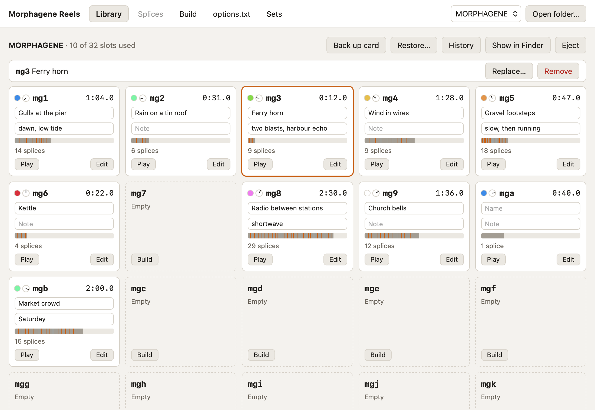

# The Library

The Library shows the open card's 32 slots, `mg1` to `mgw`, in the order the
module counts them. A card shows up in the picker at the top right when it
mounts. **Open folder…** opens any folder that holds reels instead, such as a
copy of a card or a backup.

## Tiles

Each reel's tile shows:

- a coloured dot: the colour the module's Reel Activity Window shows for this
  reel in Reel mode;
- a small dial: about where the Organize knob selects this reel in Reel mode;
- the slot, such as `mg3`, and the reel's length;
- its name and note, which you type in place;
- a bar of its length against the 2.9 minute limit, with a tick at each splice
  marker;
- how many splices it has;
- **Play**, which plays the reel from its start, and **Edit**, which opens it
  in [Splices](splices.md).

An empty slot has **Build**, which opens [Build](build.md) with that slot as
the target. A tile with a red border and a `!` has something the module won't
accept; hover over the `!`, or pick the tile, to see what.

The colours and dial positions follow the Reel mode diagram in the manual. The
app counts reels in slot order and spreads the Organize zones evenly, which
hasn't been checked on a module yet.

## Picking a tile

Click a tile to pick it. The bar above the tiles then holds what's less often
needed for that slot:

- **Replace…** builds a new reel into the slot.
- **Convert** rewrites a reel that isn't 48 kHz 32-bit float stereo, keeping
  its markers. It shows only when a reel needs it.
- **Remove** deletes the reel, after copying it to the backups folder.

With the tiles focused, the arrow keys move the pick, and Enter or a
double-click opens the picked slot.

## Moving reels

Drag a reel onto another slot to move it there; the reels between shift along
to make room. Hold Option as you drop to swap the two reels instead. Names and
notes go with their reels.

## Names and notes

A name and a short note for each reel make it easier to find the one you want
on the module. They're saved as you leave the field, or press Enter; Escape
puts back what was there.

The app keeps them in `mgreel.json` at the root of the card, keyed by slot, and
moves them when it moves a reel. It can't see a reel moved or deleted on the
module or in Finder, so a name stays with its slot in that case. If
`mgreel.json` can't be read, the card check says so, and the app won't move,
remove or name reels until it's fixed or removed.

## The card check

When a card opens, the app looks it over and lists what the module won't like,
each with a fix:

- **Not FAT32.** The module reads only FAT32 cards. Back the card up, format it
  as MS-DOS (FAT) in Disk Utility, then restore the backup.
- **WAV files it won't load**, because of their name (such as `mg0.wav` or
  `take 1.wav`) or because they're in a folder. **Put in mgN** converts one
  into the first free slot, with its markers, and backs up and removes the
  original.
- **Files that aren't WAV**, which you'll need to convert elsewhere first.
- **macOS metadata files** (`._` files and `.DS_Store`). **Remove** deletes
  them.
- **An unreadable `mgreel.json`.** **Remove** backs it up and deletes it.

## Backups and history

Before the app changes or deletes a reel, `options.txt` or `mgreel.json` on the
card, it copies the old one to
`~/Library/Application Support/com.rlhatcher.mgreel/backups/<card name>/`.
macOS metadata files are deleted without a copy.

When a card mounts, the app also copies any reel it hasn't seen before, such
as one you recorded or spliced on the module, before anything can replace it.
The first time it sees a card, that's every reel, so expect the folder to hold
about a card's worth per card.

- **Back up card** copies every reel, `options.txt` and `mgreel.json` into a
  new folder.
- **Restore…** replaces the card's reels and reel names with a backup you
  pick, and its `options.txt` if the backup has one. Other files stay. The
  card is backed up first.
- **History** lists every backup, newest first. Click a file to put that copy
  back on the card.
- **Show in Finder** opens the card's backups folder.

## Ejecting

**Eject** unmounts the card so you can take it out, once any name you're
typing has been saved.
