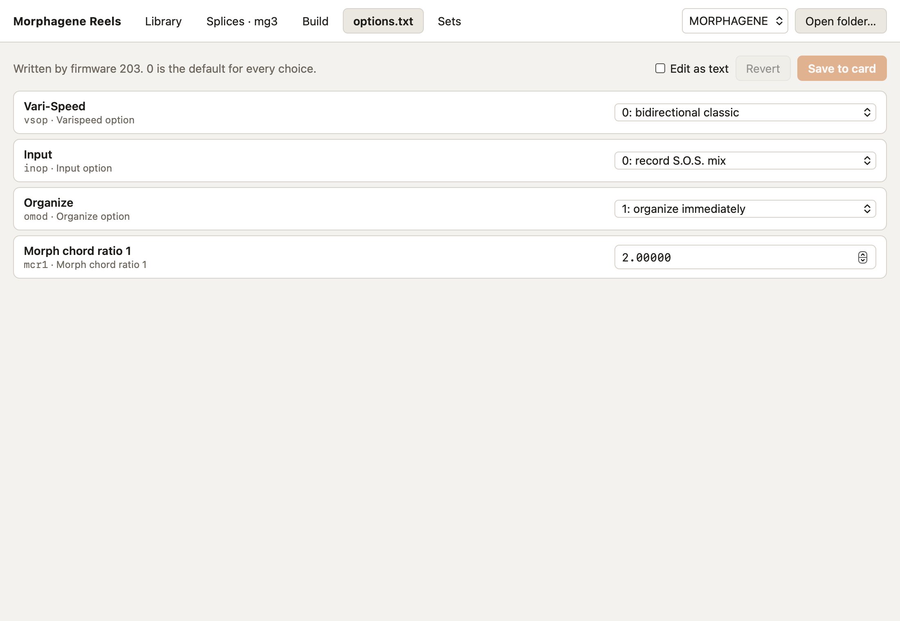

# options.txt

The Morphagene writes `options.txt` to the root of the card the first time it
mounts it, with firmware MG155 or later. The file sets firmware options such as
how Vari-Speed responds, what gets recorded, and when Organize takes effect.
The manual covers what each one does.

This page shows each option with its name, its key and the comment the module
wrote, and a menu or a number to change it. 0 is the default for every choice.
A changed option is outlined until you save.

Saving changes only the values. The comments the module wrote, and any line
the app doesn't know, stay as they are, as the manual asks. **Save to card**
copies the old file to the backups folder first, and **Revert** reads it back
from the card.

**Edit as text** shows the whole file to edit by hand instead.

If the card has no `options.txt` yet, put it in the module once and the module
will write one.
