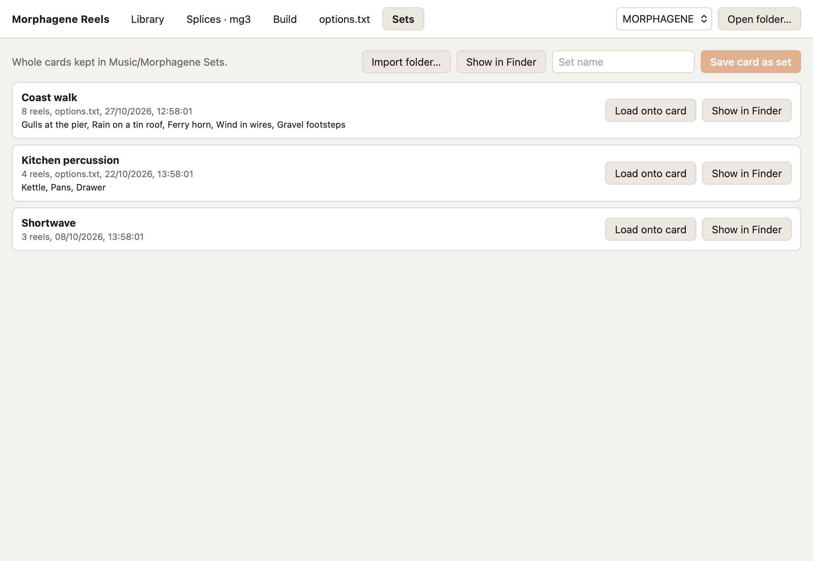

# Sets

The module reads one card at a time, with one `options.txt`. A set keeps a
whole card on your Mac, so one card can hold different setups in turn.

Each set is a folder in `~/Music/Morphagene Sets`, laid out like a card: the
reels, `options.txt` and `mgreel.json` with the reel names. You can copy one to
a card by hand, zip it to share, or back it up with your other audio.

## Saving the card

Type a name and press **Save card as set**. The set is written to a hidden
folder first and renamed when it's complete, so a save that fails leaves
nothing behind. A name already in use is refused.

## Loading a set

**Load onto card** replaces every reel, `options.txt` and the reel names on the
open card with the set's. The card is backed up first. If the load fails
partway, the app removes the card's names file rather than leave names on the
wrong reels, and the message says where the backup is.

## Importing a folder

**Import folder…** makes a set from a folder of WAV files, such as a reel pack
you've downloaded:

- Every file is converted to 48 kHz 32-bit float stereo, keeping its markers.
- Files named `mg1.wav` to `mgw.wav` at the top of the folder keep their
  slots, and their names from the folder's `mgreel.json` if it has one.
- The other files, subfolders included, fill the free slots in the order
  Finder lists them ("Take 2" before "Take 10"). Each file's name becomes its
  reel's name.
- A file that can't be read is left out, and the next file takes its slot.
- A folder with more than 32 WAV files is refused before anything is written.

The set takes the folder's name, with a number added if that's taken. A report
lists where each file went, any reel the module would refuse (too long, too
many markers), and the files left out with the reason.

**Show in Finder** opens the sets folder, or one set.
