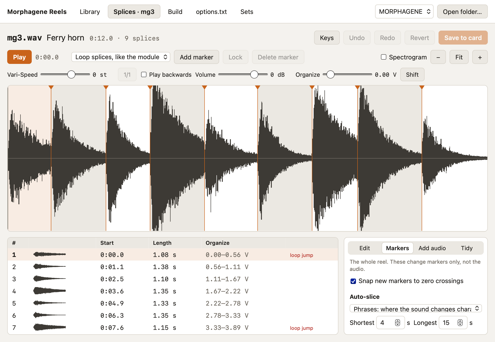

# Splices

Splices opens one reel: its waveform with the splice markers, the list of
splices, and the tools. Open it with **Edit** on a tile in the
[Library](library.md). Nothing reaches the card until **Save to card**, which
copies the old reel to the backups folder first. **Revert** goes back to what's
on the card.

## Playback

**Play** plays from the cursor. The menu next to it picks how:

- **Loop splices, like the module.** The splice under the cursor loops. Move
  **Organize** (0 to 5 V, spread evenly over the splices) or press **Shift**,
  and the next splice starts when the current one ends, as on the module.
- **Play through the reel**, from start to end.

**Vari-Speed** changes speed and pitch together, from 12 semitones up to 26
down, as on the module; **1/1** resets it. **Play backwards** and **Volume**
change only what you hear, not the reel.

**Spectrogram** shows frequency over time instead of the waveform. **−**,
**Fit** and **+** zoom; scrolling sideways pans, and Cmd-scroll or a pinch
zooms.

## Markers

- **Add marker**, M or a double-click on the waveform adds one at the
  playhead or cursor.
- Drag a marker to move it. Click one to pick it, then **Lock** (K) keeps it
  in place through auto-slice, split and delete, and **Delete marker**
  (Delete) removes it.
- **Snap new markers to zero crossings**, under the Markers tools, moves a new
  or dragged marker up to 2 ms to the nearest zero crossing, so the splice
  starts without a click.

The module allows 300 splices and 2.9 minutes; the editor warns above either,
and won't save until the reel fits.

## The splice list

Each row shows a splice's number, a small waveform, where it starts, how long
it is, and the Organize voltages that select it. **loop jump** marks a splice
whose end jumps hard back to its start, which can click as it loops; Smooth
loop fixes that.

Click a row to pick a splice, Shift-click to pick a run, and drag rows to
reorder them. The tools act on the picked splices, or on the one under the
cursor when nothing is picked.

## Tools

The tools sit in four tabs. Each says what it acts on.

**Edit** changes the audio of the picked splices:

- Cut, Copy, Paste (after the pick, also into another reel), Duplicate,
  Delete.
- Reverse, Shuffle (a random order), Match levels (each to their average
  loudness, so Organize doesn't jump in level), Remove DC.
- Gain in dB, Normalize to a peak in dBFS, Fade in and Fade out.
- Smooth loop: crossfades each splice's end into its start so it loops without
  a jump. The splice gets shorter by the crossfade.
- High-pass at a cutoff in Hz.
- Change speed in semitones, like tape: pitch and length together.

**Markers** changes only the markers, never the audio:

- **Auto-slice** listens for changes in level and spectrum, not pitch or beat,
  so it works on any sound, and cuts in the quiet between sounds. Phrases
  finds where the sound changes character; Gestures finds each distinct sound
  event. Set the shortest and longest splice and how many at most. It
  replaces the markers that aren't locked.
- **Split evenly** into a number of equal splices, keeping locked markers.
- **Import markers…** from a file. See below.
- **Remove unlocked markers.**

**Add audio**:

- **Insert files…** puts WAV files after the pick, one splice each. Dropping
  WAV files on the editor does the same.
- **Replace with file…** swaps one splice for a file.
- **Mix in file…** mixes a file into one splice, with an S.O.S. balance like
  the module's: 0% keeps only the file, 100% only what was there.
- **Export as WAV files…** saves each picked splice as its own file.

**Tidy**, for reels recorded or spliced on the module. Each works on the whole
reel:

- **Delete silent splices**: every splice that stays below the silence level.
- **Trim silent starts**: cuts the silence at the start of each splice, keeping
  5 ms before the sound so the attack stays.
- **Merge splices shorter than** a length into whichever neighbour is shorter.
  Locked markers stay.

## Importing markers

**Import markers…** reads markers made elsewhere and puts them on the reel:

- **Audacity** label files (`.txt`). A label that spans a region adds a marker
  at each end.
- **REAPER** marker and region exports (`.csv`) from the Region/Marker
  Manager, with time shown as minutes:seconds or seconds. Measures and beats
  need the tempo, so they're refused; change the time format and export again.
- **Ableton Live** sets (`.als`): the locators, at the set's tempo. If the
  tempo changes during the set, markers after the first change will be off,
  and the app warns you.
- **WAV** files: their cue points, and the end of each region RX or Pro Tools
  saved.

If the audio was exported from later than the start of the timeline, set
**Audio starts at** to how much later. Markers that fall outside the reel are
left out, and the message says how many. **Replace the unlocked markers**
replaces instead of adding.

## Undo

Undo and redo cover every marker and audio change. The history keeps about
380 MB of audio; older audio edits drop off past that.

## Keys

**Keys** at the top lists them:

| Key | Does |
| --- | --- |
| Space | Play or stop, from the cursor |
| M, double-click | Add a marker |
| Delete | Delete the picked marker |
| K | Lock or unlock the picked marker |
| ← → | Previous or next splice |
| S | Shift to the next splice |
| L | Loop splices or play through |
| + − 0 | Zoom in, out, show all |
| Shift-click | Pick a run of splices in the list |
| Cmd-A | Pick every splice |
| Escape | Stop playback and any drag |
| Cmd-C, X, V, D | Copy, cut, paste, duplicate splices |
| Shift-Delete | Delete the picked splices |
| Cmd-Z | Undo; with Shift, redo |
| Cmd-S | Save to the card |
